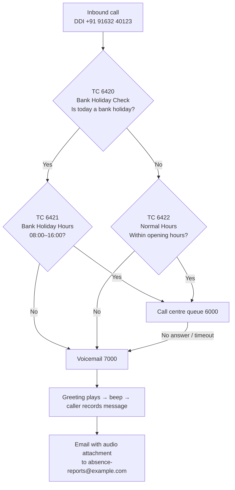

# Absence Line – FusionPBX Configuration- Greetings recording - Call centre queue - Destination DDI- time conditions - voicemail

Example setup for a dedicated line for agents to report absence or lateness. During opening hours, calls go to a call centre queue. Outside opening hours, callers hear a recorded message and leave a voicemail, which is emailed to a notification mailbox with the recording attached.

> **Note:** All names, numbers, email addresses and domains in this document are examples. Replace them with your own values. Never commit SMTP credentials or voicemail PINs.

---

## Summary

| Item | Value |
|---|---|
| Platform | FreeSWITCH / FusionPBX |
| DDI | +91 91632 40123 |
| In-hours destination | Call centre queue **6000** – Absence Line |
| Out-of-hours destination | Voicemail box **7000** – Absence Line |
| Notification email | absence-reports@example.com |
| Email sender | Example Voicemails `<voicemail@example.net>` |
| Mail relay | AWS SES Mail Manager (SMTP, port 587, STARTTLS) |
| Time zone | Europe/London |

---

## Opening hours

| Day | Hours |
|---|---|
| Monday – Friday | 07:00 – 21:00 |
| Saturday | 08:00 – 19:00 |
| Sunday | 08:00 – 18:00 |
| Bank holidays | 08:00 – 16:00 |

---

## Call flow

Bank holidays are checked first. FusionPBX uses the first time condition that matches, and most bank holidays fall on weekdays, so a single combined condition would keep the line open until 21:00 instead of 16:00.

---

## Configuration

### 1. Voicemail box – 7000

**Location:** Apps > Voicemail

| Field | Value |
|---|---|
| Voicemail ID | 7000 |
| Password | Numeric PIN (stored separately, not in this repo) |
| Play Tutorial | Off |
| Greeting | Greeting 1 |
| Alternate Greeting ID | Blank |
| Recording Instructions | Off (the custom greeting already gives instructions) |
| Recording Options | Off (message saves when the caller hangs up) |
| Options | Blank |
| Mail To | absence-reports@example.com |
| Voicemail File | Audio File Attachment |
| Keep Local After Email | On (copy kept on the PBX as a backup) |
| Forward Destinations | Blank |
| Enabled | On |
| Description | Absence Line |

**Greeting:** `greeting_1.mp3` (about 10.5 seconds) is uploaded as Greeting 1 and selected as active.

MP3 playback in FreeSWITCH needs `mod_shout` to be loaded. If callers hear silence or the default system greeting, upload the 8 kHz, 16-bit mono WAV version (`greeting_1.wav`) instead. The WAV doesn't need any extra module.

Recommended greeting wording:

> "Thank you for calling the Absence Line. Our office is currently closed. Please leave your full name, the reason for your absence or lateness, and when you expect to return, and your message will be passed on to the team. Please speak after the tone."

### 2. Call centre queue – 6000

**Location:** Apps > Call Center

| Field | Value |
|---|---|
| Queue name | Absence Line |
| Extension | 6000 |
| Timeout / no-agent action | Voicemail 7000 |
| Tiers | Agents answering the line |

### 3. Time conditions

**Location:** Dialplan > Time Conditions

Create the conditions in this order (6422, 6421, then 6420), because each one can only point to a time condition that already exists.

#### TC 6422 – Normal Hours

| Group | Conditions | Destination |
|---|---|---|
| 1 | Day of Week: Mon–Fri **and** Time of Day: 07:00–21:00 | Queue 6000 |
| 2 | Day of Week: Saturday **and** Time of Day: 08:00–19:00 | Queue 6000 |
| 3 | Day of Week: Sunday **and** Time of Day: 08:00–18:00 | Queue 6000 |
| Alternate | – | Voicemail 7000 |

#### TC 6421 – Bank Holiday Hours

| Group | Conditions | Destination |
|---|---|---|
| 1 | Time of Day: 08:00–16:00 | Queue 6000 |
| Alternate | – | Voicemail 7000 |

#### TC 6420 – Bank Holiday Check

Add one condition group for each bank holiday date, each with TC 6421 as its destination. The alternate destination is TC 6422.

The dates must be in separate groups. Conditions within a group must all match together, and no single day can match two different dates.

### 4. Inbound destination (DDI)

**Location:** Dialplan > Destinations

| Field | Value |
|---|---|
| Type | Inbound |
| Country Code | +91 |
| Destination | 91632 40123 |
| Context | public |
| Action | Time Condition 6420 – Bank Holiday Check |

> If the DDI points directly at voicemail 7000, **all** calls go to voicemail at any time of day. Make sure the action is set to TC 6420.

### 5. Email (global settings)

**Location:** Advanced > Default Settings > Email

| Setting | Value |
|---|---|
| method | smtp |
| smtp_auth | True |
| smtp_host | AWS SES Mail Manager authenticated ingress endpoint |
| smtp_port | 587 |
| smtp_secure | tls |
| smtp_from | voicemail@example.net |
| smtp_from_name | Example Voicemails |
| smtp_validate_certificate | True |
| smtp_username / smtp_password | Stored in FusionPBX only (not in this repo) |

The domain's time zone must be **Europe/London** (Accounts > Domains, or Default Settings), so the opening hours stay correct when the clocks change between GMT and BST.

---

## Bank holidays 

These dates must be added to TC 6420.

| Date | Holiday |
|---|---|
| 2026-12-25 | Christmas Day |
| 2026-12-28 | Boxing Day (substitute day) |
| 2027-01-01 | New Year's Day |
| 2027-03-26 | Good Friday |
| 2027-03-29 | Easter Monday |
| 2027-05-03 | Early May bank holiday |
| 2027-05-31 | Spring bank holiday |
| 2027-08-30 | Summer bank holiday |
| 2027-12-27 | Christmas Day (substitute day) |
| 2027-12-28 | Boxing Day (substitute day) |

---

## Testing

| Test | How | Expected result |
|---|---|---|
| Out of hours | Call the DDI outside opening hours (e.g. after 21:00 on a weekday) | Greeting → beep → recording. A new row appears in Status > Email Queue with status **Sent**, and the email arrives with the audio attached |
| In hours | Call the DDI during opening hours | Call enters queue 6000 |
| Queue timeout | Call in hours with no agents available | Call falls back to voicemail 7000 |
| Bank holiday | Temporarily add today's date as a group in TC 6420, then call inside and outside 08:00–16:00 | Queue inside those hours, voicemail outside. **Remove the date afterwards.** |
| Greeting playback | Call box 7000 directly | Custom greeting plays (if not, see the MP3 note in section 1) |

---

## Troubleshooting

### Email shows "Sent" but the client hasn't received it

A status of **Sent** in the Email Queue means AWS accepted the email. It does not confirm delivery to the recipient's inbox.

1. **Confirm the call reached voicemail.** Search the Email Queue for the notification address, and check Status > Call Detail Records for the DDI. Calls during opening hours go to the queue and don't create an email.
2. **Retrieve the recordings.** With Keep Local After Email turned on, recordings are under Apps > Voicemail > 7000 > Messages and can be forwarded to the client by hand.
3. **Check for bounces.** Look in the voicemail@example.net mailbox for bounce messages (non-delivery reports), and check the AWS SES / Mail Manager logs and bounce notifications.
4. **Send a test to a second address.** Temporarily set Mail To to `absence-reports@example.com, <internal test address>` and leave a test message.
   - If only the internal copy arrives, the problem is on the recipient's side.
   - If neither arrives, the problem is in AWS.
5. **Recipient-side checks (client IT):**
   - Run a message trace for emails from `voicemail@example.net` (Microsoft 365: Exchange admin center > Mail flow > Message trace).
   - If the notification address is a distribution group, turn on **"Allow messages from people outside my organization"**. Microsoft 365 rejects outside senders by default.
   - Check quarantine and junk, and add `voicemail@example.net` as an allowed sender.
   - Check attachment policies that might block `.mp3` or `.wav` files.
6. **Sender authentication.** Make sure example.net has an SPF record that includes Amazon SES, DKIM enabled in SES, and a DMARC record in place.

### Callers hear silence instead of the greeting

Upload `greeting_1.wav` in place of the MP3, or enable `mod_shout` under Advanced > Modules.

### Hours are an hour out

Check that the domain time zone is set to Europe/London.
